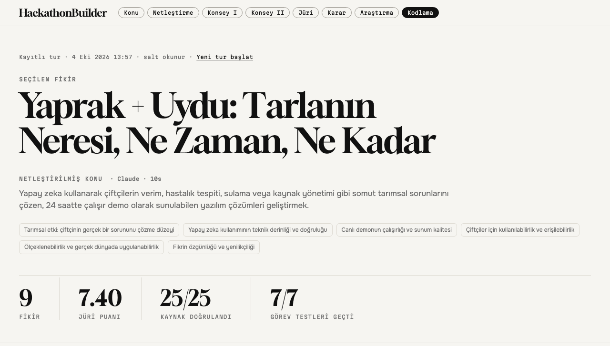
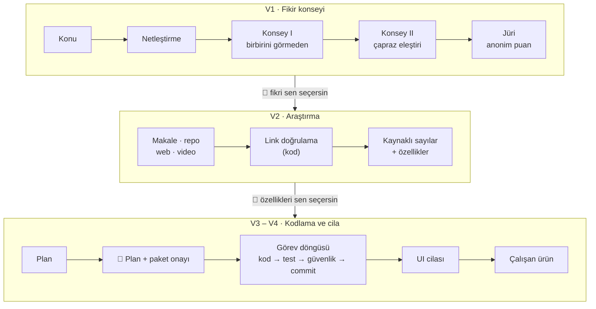
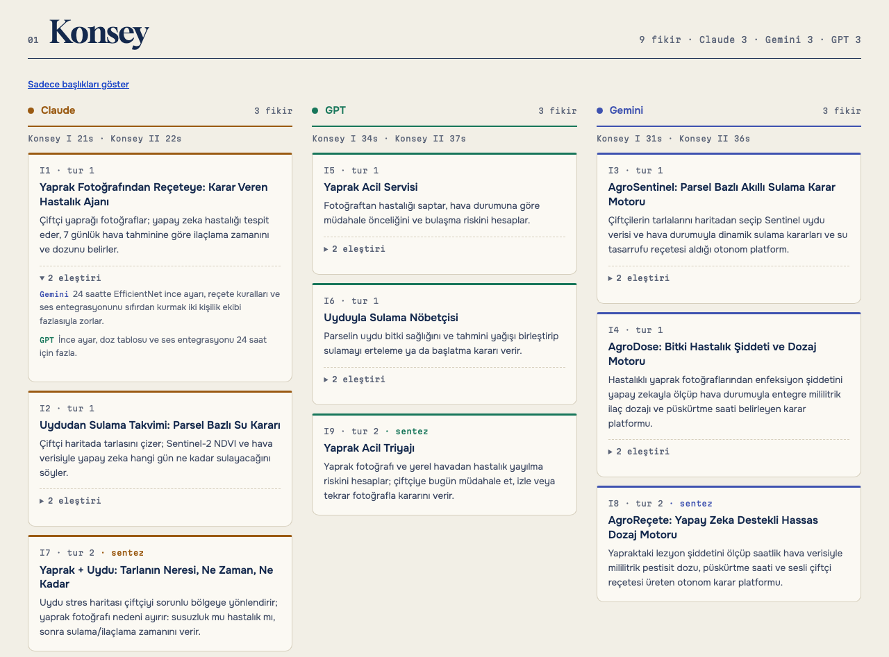
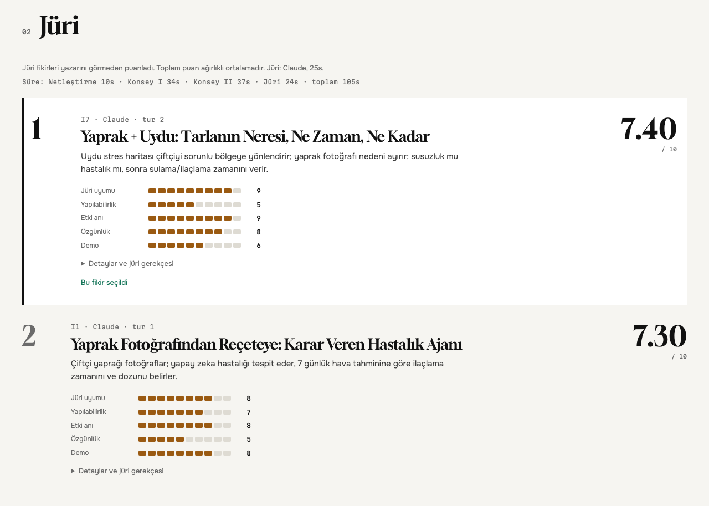
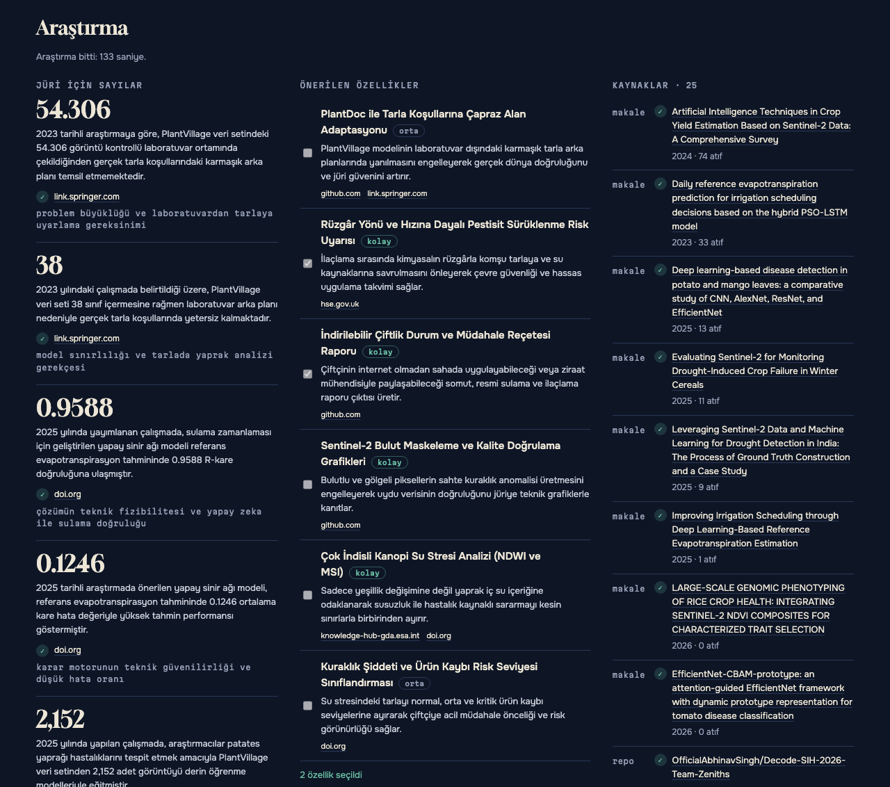
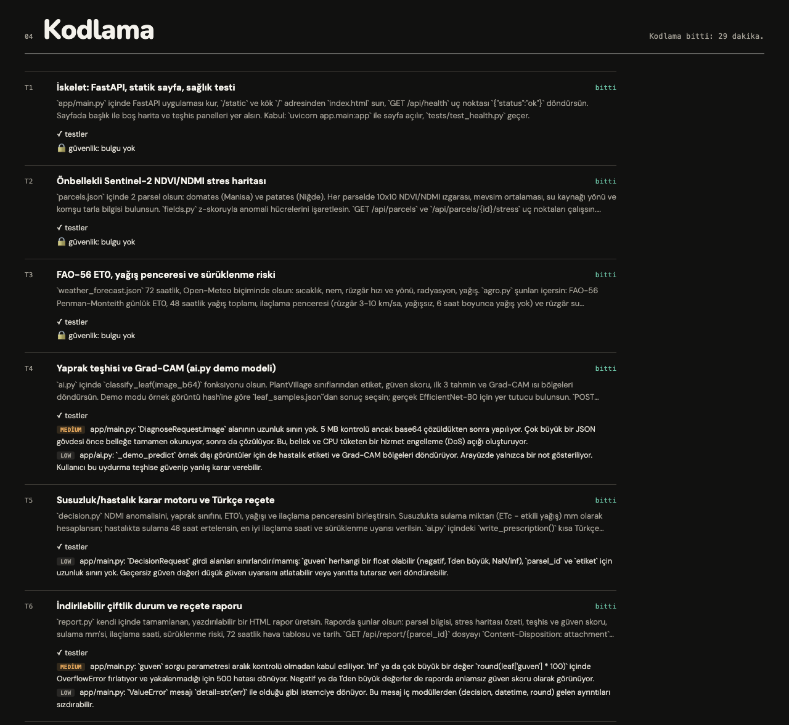
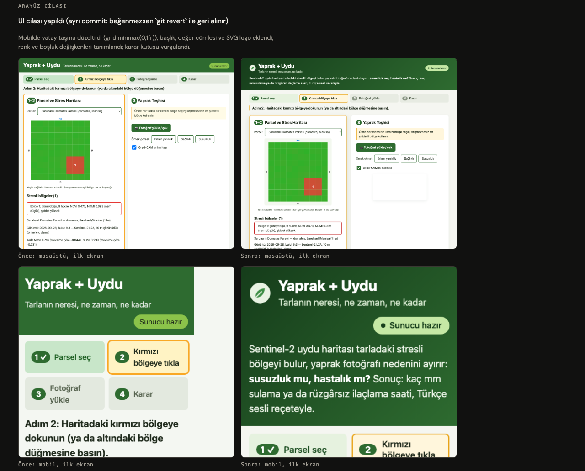
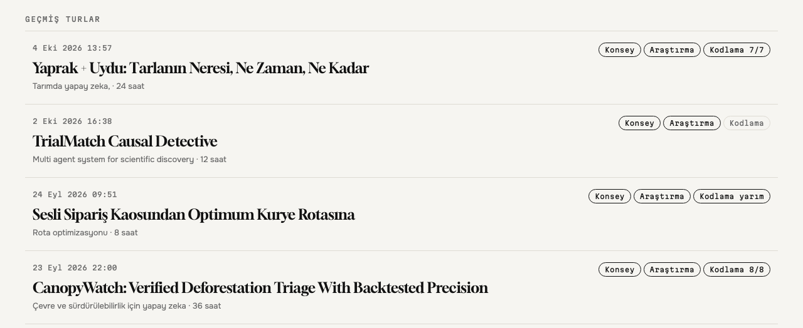

<div align="center">

# HackathonBuilder

**Hackathon konusundan çalışan ürüne tek boru hattı.**<br>
Üç yapay zekâ modeli işi yapar, kararları sen verirsin.


[Nasıl çalışır](#nasıl-çalışır) · [Kurulum](#kurulum) · [Kullanım](#kullanım) · [Güvenlik](#güvenlik) · [Sunum (PDF)](docs/sunum.pdf)

</div>



Hackathon konusunu gir. Claude, GPT ve Gemini'den oluşan bir konsey fikir üretir ve birbirinin fikirlerini eleştirir. Bir jüri modeli fikirleri puanlar, son kararı sen verirsin. Seçtiğin fikir için makale, repo, web ve video kaynakları toplanır; jüriye gösterebileceğin, kaynağı doğrulanmış sayılar ve eklenebilecek özellikler çıkarılır. Sonra ajanlar fikri koda döker: plan, görev görev kod, test, güvenlik incelemesi ve arayüz cilası.

**API key gerekmez.** Modeller kendi aboneliklerinle, resmi CLI'lar üzerinden çağrılır: Claude Code, Codex CLI ve Antigravity (`agy`). Üçü birden şart değil: hangisi kuruluysa o çalışır ([ayrıntı](#hangi-model-ne-işe-yarar)). Her şey senin bilgisayarında çalışır.

## Neden

Hackathonda iki engel var: **zaman** ve **hata**. Ajanlar olmayan kaynak uydurur, abartılı iddia kurar, kırık kod yazıp "testler geçti" der, güvenlik açığı bırakır. Bu yüzden HackathonBuilder'ın özü kod üreten ajanlar değil, **onların hatalarını yakalayan katman**:

| Ajan hatası | Yakalayan katman |
|---|---|
| Uydurma kaynak | Makale ve repolar resmi API'lerden gelir, her link kodla doğrulanır |
| Kaynaksız sayı | Toplanan listede olmayan bir linke dayanan sayı veya özellik kodla atılır |
| "Testler geçti" demesi | Testleri ajan değil uygulama çalıştırır |
| Güvenlik açığı | Her görevin diff'i incelenir, hangi seviyenin düzeltileceğini sen seçersin |
| Arayüzü bozan cila | Test, JS hatası veya demo adımı kırılırsa cila tamamen geri alınır |
| Yanlış yön | Fikri, özellikleri, planı ve paketleri sen onaylarsın |

## Gerçek bir tur

Bu README'deki tüm ekran görüntüleri aynı gerçek turdan: **"Tarımda yapay zeka · 24 saat · 2 kişi"**.

| Konsey | Araştırma | Kodlama |
|:---:|:---:|:---:|
| **9** fikir · 105 sn | **25/25** kaynak doğrulandı · 133 sn | **7/7** görev · **102** test geçti · 29 dk |

Seçilen fikir (jüri 7.40 / 10): **Yaprak + Uydu.** Uydu haritası tarladaki stresli bölgeyi bulur, yaprak fotoğrafı nedeni ayırır: susuzluk mu, hastalık mı? Güvenlik incelemesi 2 medium + 5 low bulgu raporladı. Bulgular sonra düzeltildi ve aynı bulgu tipleri kodlayıcıya önleyici kural olarak eklendi.

## Nasıl çalışır



### 1 · Konsey

- **Netleştirme:** Claude konuyu netleştirir ve jüri kriterlerini çıkarır.
- **Konsey I:** Üç model birbirinin fikrini görmeden 2'şer fikir yazar, böylece birbirlerini etkilemezler (anchoring).
- **Konsey II:** Herkes diğerlerinin fikrini eleştirir ve geliştirilmiş bir fikir önerir.
- **Jüri:** Fikirleri yazarını bilmeden beş kritere göre puanlar. Toplam puanı model değil kod hesaplar (ağırlıklı ortalama).
- **Model düşerse:** Konsey kalan modellerle devam eder. Netleştirme ve jüri adımlarında sıradaki modele geçilir.
- Bir tur genelde **1.5-3 dakika** sürer (süre servislerin anlık yüküne göre değişir).





### 2 · Araştırma

| Kaynak | Nereden |
|---|---|
| Makaleler | OpenAlex API |
| Repolar | GitHub API + README okuma |
| Web | GPT web araması |
| Videolar | Claude web araması + YouTube oEmbed doğrulaması |

- **Uydurma kaynak üretilemez:** Makale ve repolar resmi API'lerden gelir. LLM sadece sorgu yazar, seçer ve analiz eder.
- **Her link kodla doğrulanır:** ✓ doğrulandı, ? site erişimi engelledi, ✗ ulaşılamadı (listeden çıkarılır).
- **Alaka kodla korunur:** Makaleler her sorgunun en alakalı sonuçlarından sırayla seçilir, aynı sırada yenisi önce gelir (atıf sayısına göre sıralamak eski genel derlemeleri öne çıkarıyordu). 3'ten az repo bulunursa sorgular kısaltılıp yeniden aranır. Bir videonun gerçek başlığı (YouTube oEmbed) konuyla hiç kelime paylaşmıyorsa video atılır; modelin yazdığı başlığa bakılmaz.
- **Kaynak filtresi:** Bir sayı veya özellik, toplanan listede olmayan bir linke dayanıyorsa kodla atılır.
- **Gemini sadece analiz yapar**, web'e çıkmaz. Web araması Claude ve GPT'de.
- Bir araştırma turu genelde **1.5-2.5 dakika** sürer. Web araması Claude kotasını normal çağrılardan hızlı harcar.



### 3 · Kodlama

Plan onaylanınca görevler (en fazla 8) sırayla koşar: **kod → test (en fazla 3 düzeltme) → güvenlik incelemesi → commit.**

- **Sabit stack:** FastAPI + HTML/JS. Testler `unittest`.
- **Ürün HackathonBuilder'ın dışına yazılır:** `~/HackathonBuilderProjects/<tur-klasörü>/`. Her ürün kendi git reposudur, her görev ayrı commit olur. Sızıntı kontrolü hook'u ürüne de kurulur.
- **Kodu hangi model yazar:** Kurulu olan ilki: Claude → Codex → Gemini. `HB_CODER=claude|codex|gemini` ile seçebilirsin. Hangisinin yazacağı plan onayında görünür.
- **Kodlayıcı sandbox'ta çalışır (macOS):** Claude ve Gemini, macOS'un yerleşik işletim sistemi sandbox'ında (`sandbox-exec`) çalışır ve proje klasörü dışına yazamaz. Ağ bağlantıları açıktır, çünkü kendi sunucularına ulaşmaları gerekir; ama sadece dosya okuma/düzenleme yapabilirler, komut çalıştıramazlar. Codex kendi sandbox'ını kurar ve orada internet tamamen kapalıdır. **Windows'ta sandbox yok:** kodlayıcı yalnızca CLI'ın kendi izin kısıtlarıyla çalışır, plan onayında bu konuda uyarı gösterilir.
- **Testleri ajan değil uygulama çalıştırır.** Ajanın "testler geçti" demesine güvenilmez.
- **Güvenlik incelemesi:** Her görevin diff'ini Claude inceler. Hangi bulguların düzeltileceğini plan onayında seçersin: sadece high, high + medium (varsayılan) veya hepsi. Kalanlar raporda görünür.
- **Paketler:** Kodlayıcı paket kuramaz. Onayladığın paketleri uygulama, projenin `.venv`'ine kurar.
- **Durdur / devam et:** Kota dolarsa veya durdurursan, biten görevler commit'lerden bulunur ve kalanlardan devam edilir.
- **Tek tıkla açma:** Kodlama bitince projeye `Baslat-Mac.command` (macOS) ve `Baslat-Windows.bat` (Windows) eklenir. Çift tıklayınca uygulama başlar ve tarayıcıda açılır. Başka bir bilgisayarda ilk açılışta Python ortamını kendisi kurar; bunun için `requirements.txt` kodun import ettiği paketlerden çıkarılır. Windows'ta Python kurulu olmalı.



### 4 · UI cilası

Görevler bitince bir ajan kodu okuyup jüri demosunu tarayıcı adımlarına çevirir (tıkla, doldur, seç, dosya yükle, bekle). Uygulama sandbox'ta açılır, demo adımlarıyla gezilir ve ekranlar masaüstünde ve mobilde çekilir. UI ajanı görüntülere bakıp sadece `app/static/`'i (HTML/CSS/JS) iyileştirir: ilk izlenim, hiyerarşi, renk paleti, mobil, erişilebilirlik.

- **Ürünü bozamaz:** Cila sonrası testler çalışır, sayfa yeniden çekilir, konsol hataları ve mobilde yatay taşma kodla kontrol edilir. Sorun çıkarsa ajana bir kez düzelttirilir. Test kırılırsa, yeni JS hatası çıkarsa veya önce çalışan bir demo adımı artık çalışmıyorsa cila tamamen geri alınır.
- **Demo adımları kod değildir:** JSON listesidir; uygulamayı bizim kod yapar ve proje dışından dosya yüklenemez.
- Cila ayrı bir commit'tir, sonuçta her ekranın önce/sonra görüntüleri gösterilir.



## Kurulum

**Gerekenler:**

- **Python 3.10 veya üstü.** macOS'un hazır `python3`'ü 3.9 olduğu için yetmez; [python.org](https://www.python.org/downloads/)'dan kur. Windows'ta kurarken "Add python.exe to PATH" kutusunu işaretle.
- **En az bir model CLI'ı**, kurulu ve kendi hesabınla giriş yapılmış:

| Model | CLI | Giriş |
|---|---|---|
| Claude | [Claude Code](https://docs.anthropic.com/en/docs/claude-code) (`claude`) | `claude` çalıştır → `/login` |
| GPT | [Codex CLI](https://github.com/openai/codex) (`codex`) | `codex login` |
| Gemini | [Antigravity CLI](https://antigravity.google) (`agy`) | `agy` çalıştır → hesabınla giriş |

- **Git:** kodlama aşaması için gerekli. macOS'ta `xcode-select --install`, Windows'ta [git-scm.com](https://git-scm.com/download/win).

### Tek tıkla kurulum

Repoyu indir (`git clone` ya da GitHub'da **Code → Download ZIP**), sonra:

| | Kurulum | Başlatma |
|---|---|---|
| **macOS** | `Kurulum-Mac.command`'a çift tıkla | `HackathonBuilder.command`'a çift tıkla |
| **Windows** | `Kurulum-Windows.bat`'a çift tıkla | `HackathonBuilder.bat`'a çift tıkla |

Kurulum betiği şunları yapar:

1. Python 3.10+ arar.
2. Projeye kendi Python ortamını (`.venv`) kurar; sistem Python'una dokunmaz.
3. Paketleri yükler.
4. Sorarak, UI cilası için Chromium'u indirir (yaklaşık 200 MB).
5. Hangi model CLI'larının kurulu olduğunu gösterir. İstersen her modele kısa bir soru sorup girişini test eder.

Tekrar çalıştırmak güvenlidir. macOS ZIP'ten açılan dosyayı engellerse: dosyaya sağ tıkla → **Aç**.

<details>
<summary><b>Elle kurulum</b> (terminalden)</summary>

<br>

```bash
git clone https://github.com/aliandacerdass/HackathonBuilder.git
cd HackathonBuilder
python3 -m venv .venv && source .venv/bin/activate     # Windows: py -3 -m venv .venv && .venv\Scripts\activate
pip install -r requirements.txt
playwright install --only-shell chromium               # UI cilası için ekran görüntüsü tarayıcısı
python -m backend.runners --smoke                      # hangi modeller cevap veriyor
python -m backend.tools --selftest                     # beklenen: 10/10 (OpenAlex, GitHub, YouTube erişimi)
```

GitHub, key olmadan saatte 60 isteğe izin veriyor. Bilinen hatalar için [COMMON_ERRORS.md](COMMON_ERRORS.md).

</details>

### Hangi model ne işe yarar

Üç modelin hepsi varsa her aşama tam çalışır. Biri eksikse:

| Aşama | Claude yoksa | GPT (Codex) yoksa | Gemini yoksa |
|---|---|---|---|
| Konsey | 2 modelle devam eder; GPT'nin Türkçe çıktısındaki ç/ğ/ş düzeltilmez | 2 modelle devam eder | 2 modelle devam eder |
| Araştırma | Video kaynağı gelmez | Web kaynağı gelmez | Etkisi yok, analizi diğerleri yapar |
| Kodlama | Kodu Codex ya da Gemini yazar | Etkisi yok | Etkisi yok |

Makale ve repo kaynakları ücretsiz API'lerden (OpenAlex, GitHub) gelir, model gerektirmez. Her aşamanın yedek model sırası olduğu için tek modelle de akış kopmaz, yalnız konsey tek sesli kalır. Tek modelle uçtan uca tur henüz denenmedi.

### Ücretsiz planla kullanım

Kasım 2026 itibarıyla (planlar sık değişiyor, güncelini kendi hesabında kontrol et):

- **Claude:** Ücretsiz planda Claude Code yok; en az Pro gerekir.
- **GPT:** Codex CLI ücretsiz ChatGPT ve Go planlarında da açık, ama kotası düşük.
- **Gemini:** Antigravity CLI ücretsiz planda açık, haftalık kotayla.

Yani **ücretsiz ChatGPT + ücretsiz Gemini ile de çalışır**. Ama bir kodlama turu yaklaşık 30 dakika sürer ve çok sayıda model çağrısı yapar, ücretsiz kota büyük ihtimalle yarıda biter. Kota bitince **Kaldığı yerden devam et** ile sürdürebilirsin. Konsey ve araştırma çok daha az kota harcar.

<details>
<summary><b>Katkı verecekler için:</b> push öncesi sızıntı taraması</summary>

<br>

```bash
brew install gitleaks                    # Windows: github.com/gitleaks/gitleaks/releases
git config core.hooksPath .githooks      # her push'tan önce scripts/pre-push-check.sh çalışır
```

</details>

## Kullanım

### Tarayıcıda

`HackathonBuilder.command` (macOS) ya da `HackathonBuilder.bat` (Windows) dosyasına çift tıkla: sunucu başlar, tarayıcı kendiliğinden açılır (kapatmak için açılan pencereyi kapat). Ya da terminalden `python -m backend.app` çalıştırıp **http://127.0.0.1:8000** adresini aç.

1. **Konuyu, süreyi ve ekibi gir**, sonuç dilini seç (Türkçe/İngilizce; fikirler, araştırma ve plan bu dilde yazılır, tur içinde değişmez). **Konseyi topla**'ya bas.
2. Tur bitince istediğin fikrin kartında **Bu fikri seç**'e bas, istersen not ekle.
3. **Bu fikir için araştırma yap**'a bas. Bitince eklemek istediğin özellikleri işaretleyip **Seçili özellikleri kaydet**'e bas.
4. **Kodlamaya başla**'ya bas. Planı onaylarken hangi güvenlik bulgularının düzeltileceğini seç, sonra kurulacak paketleri onayla (reddedersen not yazarak planı bir kez yeniden yazdırabilirsin).
5. Görevler canlı akar. **Durdur** ile kesebilir, **Kaldığı yerden devam et** ile sürdürebilirsin. Bitince ürünün nasıl çalıştırılacağı ve test/güvenlik raporu gösterilir.

**Geçmiş turlar:** Ana sayfadaki listede bitmiş her tur durur. Birine tıklayınca fikirler, jüri puanları, kaynaklar, görevler ve UI cilası önce/sonra görüntüleri kayıttan anında açılır. Model çağrılmaz, kota harcanmaz. Kayıtlı tur salt okunurdur. Turlar yalnızca senin bilgisayarında tutulduğu için ilk kurulumda liste boştur.



### Terminalde

Kurulum betiğini kullandıysan önce ortamı aç: `source .venv/bin/activate` (Windows: `.venv\Scripts\activate`).

```bash
python -m backend.pipeline "Sağlıkta yapay zeka" --hours 24 --team "2 kişi, Python ve Flutter"
python -m backend.research runs/<tur-klasörü>             # decision.json olan bir tur için araştırma
python -m backend.builder runs/<tur-klasörü>              # kodlama (onaylar terminalden sorulur)
python -m backend.builder runs/<tur-klasörü> --resume     # durduysa kaldığı yerden devam
```

### Üretilen ürünü açmak

Proje klasöründe `Baslat-Mac.command` (Windows'ta `Baslat-Windows.bat`) dosyasına çift tıkla. Ya da terminalden:

```bash
cd ~/HackathonBuilderProjects/<tur-klasörü>
.venv/bin/python -m uvicorn app.main:app --port 8001      # Windows: .venv\Scripts\python -m uvicorn ...
```

### Model seçimi (isteğe bağlı)

Boş bırakılırsa her CLI'ın varsayılan modeli kullanılır.

```bash
HB_CLAUDE_MODEL=sonnet python -m backend.app      # Claude kotan zorlanıyorsa
HB_GPT_MODEL=...  HB_GEMINI_MODEL=...
HB_CODER=gemini python -m backend.app             # kodu kim yazsın: claude | codex | gemini
```

Gemini için kullanılabilir modelleri görmek için: `agy models`

<details>
<summary><b>Çıktılar:</b> her turun <code>runs/</code> altına kaydettiği dosyalar</summary>

<br>

Her tur `runs/<tarih>-<konu>/` klasörüne kaydedilir. `runs/` git'e gönderilmez, fikirlerin bilgisayarında kalır. Ürünün kodu `~/HackathonBuilderProjects/<tur-klasörü>/` içindedir.

| Dosya | İçerik |
|---|---|
| `input.json` | Girdiğin konu, süre, ekip |
| `refined.json` | Netleştirilmiş konu ve jüri kriterleri |
| `round1.json`, `round2.json` | Fikirler ve eleştiriler |
| `ranking.json` | Jüri puanları ve sıralama |
| `timings.json` | Aşama ve model süreleri |
| `decision.json` | Seçtiğin fikir ve notun |
| `research.json` | Sorgular, makaleler, repolar, web/video kaynakları, sayılar, özellikler |
| `research_timings.json` | Araştırma aşama ve model süreleri |
| `research_decision.json` | Seçtiğin özellikler ve notun |
| `plan.json` | Onaylanan kodlama planı: görevler, paketler, dosya ağacı |
| `build_options.json` | Plan onayındaki güvenlik düzeltme seviyesi ve kurulan paketler (`--resume` bunları kullanır) |
| `build.json` | Görev sonuçları, son test çıktısı, çalıştırma komutu, demo adımları |
| `build_timings.json` | Kodlama aşama süreleri |
| `ui/*.png` | UI cilası önce/sonra ekran görüntüleri: ilk ekran + en fazla 3 demo ekranı, masaüstü + mobil |

</details>

## Güvenlik

- **Sadece yerel:** Sunucu yalnızca `127.0.0.1`'de dinler, aynı ağdaki başka cihazlar erişemez. Başka sitelerden gelen istekler reddedilir (Origin kontrolü).
- **Temiz context:** Modeller proje dışındaki boş bir klasörde çalışır, proje dosyalarını görmez.
- **Güvenli gösterim:** Model çıktıları sayfaya düz metin olarak yazılır (`textContent`). Çıktının içindeki HTML/script çalışmaz. Model linklerinden sadece `http`/`https` olanlar tıklanabilir.
- **Kısıtlı web erişimi:** Araştırmada Claude'a sadece arama ve okuma araçları verilir. GPT salt okunur sandbox'ta çalışır. Skill'ler, kaynak metnindeki talimatların yok sayılmasını söyler (prompt injection).
- **Kodlama sandbox'ı (macOS):** Kodlayıcı, üretilen testler ve UI cilası sırasında açılan uygulama, macOS'un yerleşik sandbox'ında (`sandbox-exec`) çalışır ve proje klasörü dışına yazamaz. Testler internetsiz çalışır. Kodlayıcı ile UI cilası sunucusunun ağ bağlantısı açıktır: modelin kendi sunucusuna ulaşması, uygulamanın da port açabilmesi için gerekir (ağsız sandbox localhost'ta bile port açtırmıyor). Sandbox dosya *okumayı* engellemez; bu yüzden üretilen projeye de push öncesi sızıntı taraması kurulur. Paket kurulumu ve her plan senin onayınla yapılır.
- **Windows'ta sandbox yok:** Kodlayıcı yalnızca CLI'ın kendi izin kısıtlarıyla çalışır (Claude ve Gemini komut çalıştıramaz, sadece dosya düzenler); üretilen testler ve uygulama doğrudan bilgisayarında koşar. Plan onayında bu açıkça yazılır, onaylarsan riski kabul etmiş olursun.
- **Push öncesi tarama:** Her push'tan önce `scripts/pre-push-check.sh` çalışır: gitleaks, API key, kişisel yol ve e-posta taraması. Bulgu varsa push iptal edilir.

## Sınırlar

- Uzun kodlama turları abonelik kotasını zorlar.
- Süre servislerin yüküne bağlı: aynı konu 3 dakika da sürdü, 7.5 dakika da.
- Üretilen ürünler için stack sabit: FastAPI + HTML/JS.
- **Windows'ta henüz denenmedi:** kurulum, başlatma ve üretilen ürünün başlatıcısı (`Baslat-Windows.bat`) yazıldı ama gerçek bir Windows'ta çalıştırılmadı. Sorun görürsen issue aç.
- Linux'ta denenmedi; orada da sandbox yok (Windows gibi uyarıyla çalışır).

## Proje yapısı

```
backend/
  app.py        yerel web sunucusu (FastAPI + SSE)
  pipeline.py   V1: netleştirme → konsey → jüri
  research.py   V2: sorgu → kaynak toplama → doğrulama → analiz
  builder.py    V3: plan → onaylar → görev döngüsü
  ui.py         V4: sandbox'ta açma + ekran görüntüsü (UI cilası)
  runners.py    üç CLI'ı (claude, codex, agy) tek arayüzle çağırır, sandbox, kodlayıcı seçimi
  tools.py      LLM'siz araştırma araçları: OpenAlex, GitHub, link doğrulama
  history.py    geçmiş turları kayıttan yeniden oynatır
  schemas.py    her ajanın çıktı şeması (pydantic → JSON schema)
frontend/       arayüz (HTML/CSS/JS)
skills/         ajan rolleri, her biri bir .md dosyası
scripts/        push öncesi sızıntı kontrolü, sunum PDF üretici
docs/           sunum.pdf ve README görselleri
Kurulum-Mac.command, Kurulum-Windows.bat       tek tıkla kurulum
HackathonBuilder.command, HackathonBuilder.bat başlatma
```

| Dosya | Ne işe yarar |
|---|---|
| `RULES.md` | Bu projede çalışan herkes (insan ve ajan) için zorunlu kurallar |
| `tasks.md` | Fazlara göre yapılacaklar |
| `COMMON_ERRORS.md` | Bilinen hatalar ve kontrol listesi |
| `skills/*.md` | Ajan rolleri: netleştirici, konsey üyesi, jüri, sorgu yazıcı, web araştırmacı, repo inceleyici, sayı ve özellik çıkarıcı, planlayıcı, kodlayıcı, güvenlik inceleyici, demo adımı yazıcı, UI tasarımcısı |

## Yol haritası

- [x] **V1:** Fikir konseyi (netleştirme → 2 turlu konsey → jüri → karar)
- [x] **V2:** Araştırma ajanları (makale, sayısal veri, özellik, GitHub, web/YouTube)
- [x] **V3:** Kodlama döngüsü (kod → güvenlik → test → hata raporu, kullanıcı onay noktalarıyla)
- [x] **V4a:** UI/UX iyileştirme ajanı (ekran görüntüsüyle)
- [ ] **V4b:** Üretilen ürün için jüri sunumu

## Lisans

[MIT](LICENSE)
